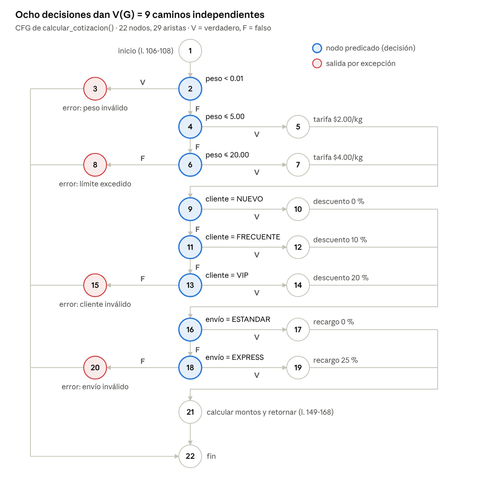
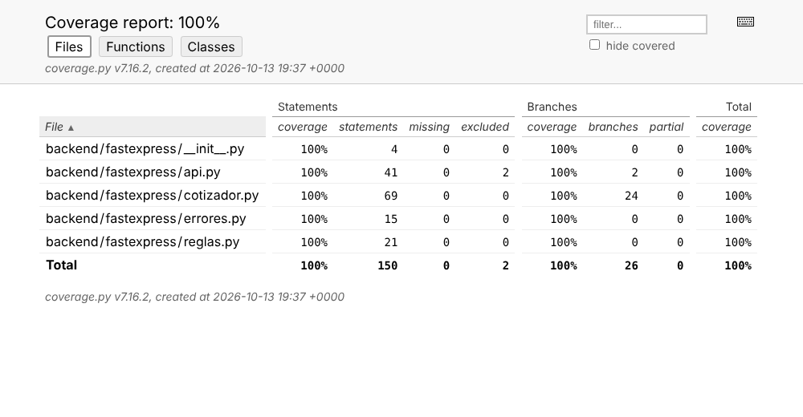
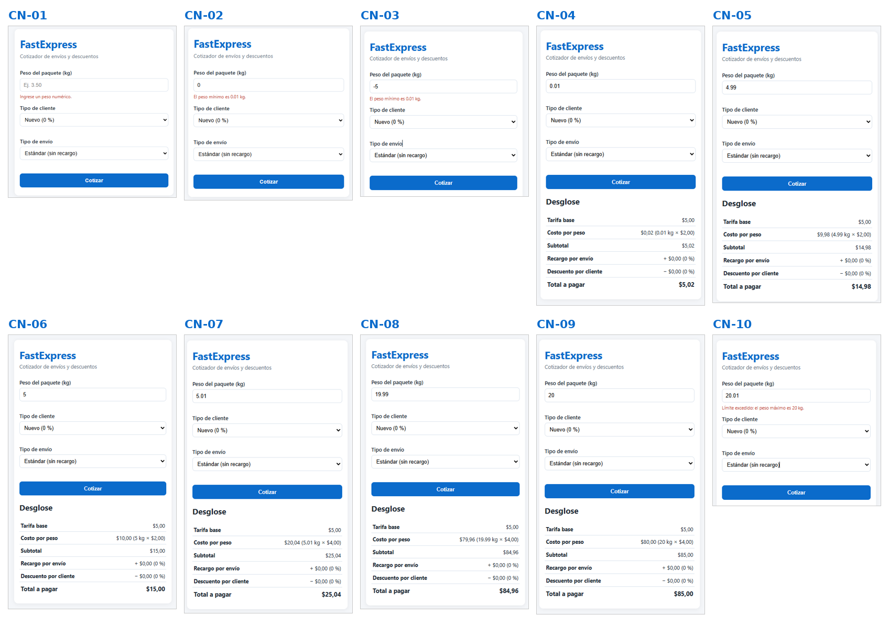
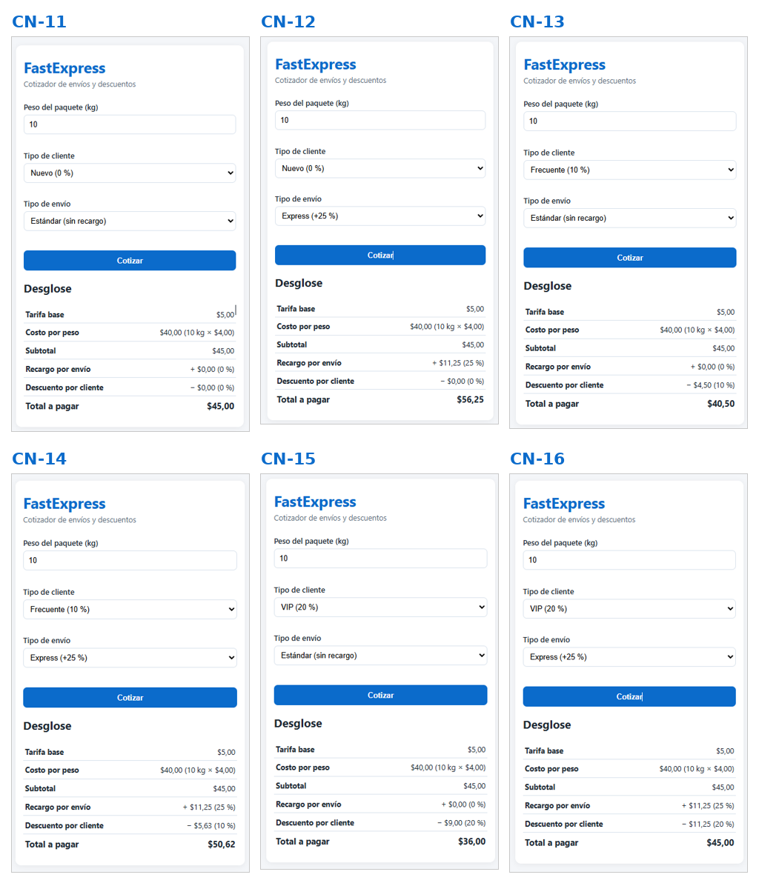
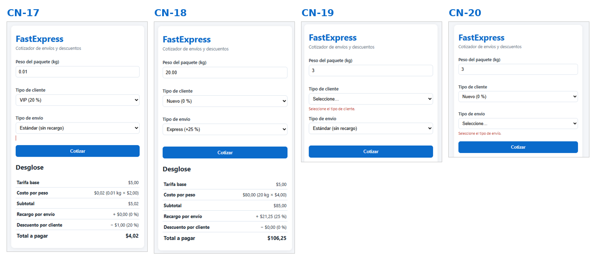

# Informe Técnico de Calidad de Software – FastExpress

14 de octubre de 2026 · Equipo FastExpress

**Equipo de desarrollo:**

| Rol | Integrante |
| --- | --- |
| Backend | Ruben Coronel |
| Frontend | Dilan Ariza |
| QA | Marcos Arce |

## 1. Introducción

El módulo FastExpress cumple las reglas BR-01 a BR-04: 82 pruebas automatizadas aprobadas, 20 de 20 casos manuales aprobados en la interfaz y 100 % de cobertura de líneas y ramas, frente al 85 % exigido. Este informe documenta el diseño de pruebas de caja negra y de caja blanca, y el reporte de cobertura, siguiendo la estructura de documentación de IEEE 829 / ISO/IEC/IEEE 29119-3 y las técnicas de diseño del programa ISTQB.

**Objeto de prueba:** función `calcular_cotizacion(peso, tipo_cliente, tipo_envio)` en `backend/fastexpress/cotizador.py` y la API REST `POST /api/cotizaciones` en `api.py`.

**Características de calidad evaluadas (ISO/IEC 25010):** adecuación funcional (completitud y corrección del cálculo) y fiabilidad ante entradas inválidas (tolerancia a fallos).

### 1.1 Reglas de negocio

| Regla | Especificación | Implementación |
| --- | --- | --- |
| BR-01 Tarifa base | $5.00 USD por orden | `TARIFA_BASE` |
| BR-02 Peso | 0.01–5.00 kg: $2.00/kg · 5.01–20.00 kg: $4.00/kg · > 20.00 kg: rechazo | `LimiteExcedidoError` (HTTP 422) |
| BR-03 Cliente | NUEVO 0 % · FRECUENTE 10 % · VIP 20 % de descuento | `DESCUENTO_*` |
| BR-04 Envío | ESTANDAR 0 % · EXPRESS +25 % sobre el subtotal | `RECARGO_*` |

### 1.2 Supuestos de diseño

El enunciado no define los siguientes puntos; el equipo adoptó estas interpretaciones:

1. El peso completo se cobra a la tarifa de su tramo (10 kg = 10 × $4.00), no por escalones.
2. Orden de cálculo: subtotal = $5.00 + peso × tarifa; recargo = subtotal × %; descuento = (subtotal + recargo) × %; total = subtotal + recargo − descuento.
3. Un peso mayor a 5.00 y menor o igual a 20.00 usa el tramo 2, lo que cubre el hueco entre 5.00 y 5.01.
4. Peso menor a 0.01, nulo o no numérico es entrada inválida (HTTP 400).
5. Los montos se redondean a centavos con redondeo comercial (ROUND\_HALF\_UP).
6. El campo **Monto** de la sección de caja negra se interpreta como el total cotizado (variable de salida), pues ninguna regla define un monto de entrada.

### 1.3 Entorno de prueba

| Elemento | Versión |
| --- | --- |
| Lenguaje | Python 3.13 |
| Framework API | Flask 3 |
| Pruebas | pytest 8 + pytest-cov (coverage.py, modo `--cov-branch`) |
| Umbral de cobertura | `--cov-fail-under=85` en `pytest.ini` |

## 2. Plan de pruebas de caja negra

Las técnicas de caja negra diseñan 34 casos sin mirar el código: particiones de equivalencia (EP) y análisis de valores límite (BVA) para Peso y Monto, y una tabla de decisión para Tipo de Cliente × Tipo de Envío. Todos están automatizados en `tests/test_cotizador.py` y `tests/test_api.py`.

### 2.1 Particiones de equivalencia: Peso

| ID | Clase | Condición | Tipo | Representante | Resultado esperado |
| --- | --- | --- | --- | --- | --- |
| CE-P1 | Tramo 1 | 0.01 ≤ peso ≤ 5.00 | Válida | 2.50 kg | Tarifa $2.00/kg, total $10.00 |
| CE-P2 | Tramo 2 | 5.00 < peso ≤ 20.00 | Válida | 12.00 kg | Tarifa $4.00/kg, total $53.00 |
| CI-P1 | Bajo el mínimo | peso < 0.01 (cero o negativo) | Inválida | −5 kg | `PESO_INVALIDO`, HTTP 400 |
| CI-P2 | Sobre el límite | peso > 20.00 | Inválida | 25 kg | `LIMITE_EXCEDIDO`, HTTP 422 |
| CI-P3 | No numérico | texto, vacío, nulo, booleano, NaN, infinito | Inválida | "abc" | `PESO_INVALIDO`, HTTP 400 |

Cliente NUEVO y envío ESTANDAR en todos los casos de peso, para aislar BR-01 y BR-02.

### 2.2 Valores límite: Peso

Se aplica BVA de tres valores (límite, límite − 0.01 y límite + 0.01) en cada frontera, con paso de 0.01 kg.

| ID | Peso (kg) | Frontera | Tarifa/kg | Total esperado |
| --- | --- | --- | --- | --- |
| BVA-P1 | 0.00 | Mínimo − 0.01 | — | Rechazo `PESO_INVALIDO` |
| BVA-P2 | 0.01 | Mínimo | $2.00 | $5.02 |
| BVA-P3 | 0.02 | Mínimo + 0.01 | $2.00 | $5.04 |
| BVA-P4 | 4.99 | Fin tramo 1 − 0.01 | $2.00 | $14.98 |
| BVA-P5 | 5.00 | Fin tramo 1 | $2.00 | $15.00 |
| BVA-P6 | 5.01 | Inicio tramo 2 | $4.00 | $25.04 |
| BVA-P7 | 19.99 | Máximo − 0.01 | $4.00 | $84.96 |
| BVA-P8 | 20.00 | Máximo | $4.00 | $85.00 |
| BVA-P9 | 20.01 | Máximo + 0.01 | — | Rechazo `LIMITE_EXCEDIDO` |

### 2.3 Particiones y valores límite: Monto

El Monto (total cotizado) es una variable de salida, por lo que sus particiones se derivan de las combinaciones de entrada que lo producen (EP de salida, ISTQB). El monto alcanzable va de **$4.02 a $106.25** y tiene un salto entre $18.75 y $20.03 por el cambio de tarifa en 5.00 kg: ningún total puede caer en ese intervalo.

| ID | Peso | Cliente | Envío | Frontera del Monto | Monto esperado |
| --- | --- | --- | --- | --- | --- |
| BVA-M1 | 0.01 | VIP | ESTANDAR | Mínimo absoluto | $4.02 |
| BVA-M2 | 0.02 | VIP | ESTANDAR | Mínimo + 1 paso | $4.03 |
| BVA-M3 | 4.99 | NUEVO | EXPRESS | Máximo tramo 1 − 1 paso | $18.73 |
| BVA-M4 | 5.00 | NUEVO | EXPRESS | Máximo tramo 1 | $18.75 |
| BVA-M5 | 5.01 | VIP | ESTANDAR | Mínimo tramo 2 | $20.03 |
| BVA-M6 | 5.02 | VIP | ESTANDAR | Mínimo tramo 2 + 1 paso | $20.06 |
| BVA-M7 | 19.99 | NUEVO | EXPRESS | Máximo − 1 paso | $106.20 |
| BVA-M8 | 20.00 | NUEVO | EXPRESS | Máximo absoluto | $106.25 |

### 2.4 Tabla de decisión: Tipo de Cliente × Tipo de Envío

Con 3 tipos de cliente y 2 tipos de envío hay 3 × 2 = 6 reglas. Peso fijo de 10 kg, así que el subtotal es $5.00 + 10 × $4.00 = $45.00 en todas.

| Condición / Acción | R1 | R2 | R3 | R4 | R5 | R6 |
| --- | --- | --- | --- | --- | --- | --- |
| C1: Tipo de cliente | NUEVO | NUEVO | FRECUENTE | FRECUENTE | VIP | VIP |
| C2: Tipo de envío | ESTANDAR | EXPRESS | ESTANDAR | EXPRESS | ESTANDAR | EXPRESS |
| A1: Recargo (25 %) | $0.00 | $11.25 | $0.00 | $11.25 | $0.00 | $11.25 |
| A2: Descuento | 0 % · $0.00 | 0 % · $0.00 | 10 % · $4.50 | 10 % · $5.63 | 20 % · $9.00 | 20 % · $11.25 |
| A3: Total | $45.00 | $56.25 | $40.50 | $50.62 | $36.00 | $45.00 |

Reglas adicionales de error: un tipo de cliente fuera de {NUEVO, FRECUENTE, VIP} devuelve `TIPO_CLIENTE_INVALIDO`, y un tipo de envío fuera de {ESTANDAR, EXPRESS} devuelve `TIPO_ENVIO_INVALIDO`, ambos con HTTP 400. Los tipos no distinguen mayúsculas ni espacios.

### 2.5 Pruebas de la API

| ID | Petición | Respuesta esperada |
| --- | --- | --- |
| API-01 | `POST` peso 10, VIP, EXPRESS | 200, total 45.00 |
| API-02 | `POST` peso 20.01 | 422, `LIMITE_EXCEDIDO` |
| API-03 | `POST` peso 0, "abc" u omitido | 400, `PESO_INVALIDO` |
| API-04 | `POST` cliente u envío desconocido | 400, `TIPO_CLIENTE_INVALIDO` / `TIPO_ENVIO_INVALIDO` |
| API-05 | `POST` cuerpo que no es objeto JSON | 400, `JSON_INVALIDO` |
| API-06 | `GET /api/salud`, `GET /api/tarifas`, `GET /` | 200 |

## 3. Plan de pruebas de caja blanca

La función `calcular_cotizacion()` tiene 8 nodos predicado, así que su complejidad ciclomática es **V(G) = 9**: se necesitan 9 casos para recorrer todos los caminos independientes, y los 9 están automatizados en `test_caminos_independientes_cfg`. Las funciones auxiliares `convertir_peso()` y `normalizar_texto()` se tratan como parte del nodo de proceso 1 para no inflar el grafo del algoritmo principal.

### 3.1 Grafo de flujo de control (CFG)



Cada `if`/`elif` es un nodo predicado con una salida V (verdadero) y otra F (falso). Las cuatro excepciones salen directamente al nodo final 22.

| Nodo | Líneas | Sentencia |
| --- | --- | --- |
| 1 | 106–108 | Convertir peso y normalizar tipos |
| 2 | 111 | `peso < 0.01` |
| 3 | 112 | `raise PesoInvalidoError` |
| 4 | 115 | `peso <= 5.00` |
| 5 | 116 | Tarifa $2.00/kg |
| 6 | 117 | `peso <= 20.00` |
| 7 | 118 | Tarifa $4.00/kg |
| 8 | 120 | `raise LimiteExcedidoError` |
| 9 | 126 | `cliente == NUEVO` |
| 10 | 127 | Descuento 0 % |
| 11 | 128 | `cliente == FRECUENTE` |
| 12 | 129 | Descuento 10 % |
| 13 | 130 | `cliente == VIP` |
| 14 | 131 | Descuento 20 % |
| 15 | 133 | `raise TipoClienteInvalidoError` |
| 16 | 139 | `envio == ESTANDAR` |
| 17 | 140 | Recargo 0 % |
| 18 | 141 | `envio == EXPRESS` |
| 19 | 142 | Recargo 25 % |
| 20 | 144 | `raise TipoEnvioInvalidoError` |
| 21 | 149–168 | Calcular montos y retornar `Cotizacion` |
| 22 | — | Fin (retorno o excepción) |

### 3.2 Cálculo de la complejidad ciclomática

El grafo tiene N = 22 nodos, E = 29 aristas y P = 8 nodos predicado (2, 4, 6, 9, 11, 13, 16 y 18). Los tres métodos dan el mismo resultado.

**Método 1: aristas y nodos.**

```latex
V(G) = E - N + 2 = 29 - 22 + 2 = 9
```

**Método 2: nodos predicado.**

```latex
V(G) = P + 1 = 8 + 1 = 9
```

**Método 3: regiones.** El grafo plano tiene 8 regiones cerradas, una por cada decisión, más la región exterior: V(G) = 8 + 1 = 9.

Un valor de 9 está en el rango de 1 a 10 que McCabe considera de riesgo bajo: el código es simple y fácil de probar.

Aristas: 1→2, 2→3, 2→4, 3→22, 4→5, 4→6, 5→9, 6→7, 6→8, 7→9, 8→22, 9→10, 9→11, 10→16, 11→12, 11→13, 12→16, 13→14, 13→15, 14→16, 15→22, 16→17, 16→18, 17→21, 18→19, 18→20, 19→21, 20→22, 21→22.

### 3.3 Caminos independientes y casos de prueba

Cada camino agrega al menos una arista que los anteriores no recorrían. Los 9 casos pasan.

| Camino | Secuencia de nodos | Peso | Cliente | Envío | Resultado esperado |
| --- | --- | --- | --- | --- | --- |
| C1 | 1-2-3-22 | 0 | NUEVO | ESTANDAR | `PesoInvalidoError` |
| C2 | 1-2-4-6-8-22 | 25 | NUEVO | ESTANDAR | `LimiteExcedidoError` |
| C3 | 1-2-4-5-9-10-16-17-21-22 | 2.50 | NUEVO | ESTANDAR | $10.00 |
| C4 | 1-2-4-6-7-9-10-16-17-21-22 | 12 | NUEVO | ESTANDAR | $53.00 |
| C5 | 1-2-4-5-9-11-12-16-17-21-22 | 1 | FRECUENTE | ESTANDAR | $6.30 |
| C6 | 1-2-4-5-9-11-13-14-16-17-21-22 | 1 | VIP | ESTANDAR | $5.60 |
| C7 | 1-2-4-5-9-11-13-15-22 | 1 | PREMIUM | ESTANDAR | `TipoClienteInvalidoError` |
| C8 | 1-2-4-5-9-10-16-18-19-21-22 | 1 | NUEVO | EXPRESS | $8.75 |
| C9 | 1-2-4-5-9-10-16-18-20-22 | 1 | NUEVO | URGENTE | `TipoEnvioInvalidoError` |

## 4. Reporte de cobertura

La suite alcanza **100 % de cobertura de líneas (150 de 150) y 100 % de ramas (26 de 26)**, 15 puntos por encima del mínimo de 85 % exigido. Las 82 pruebas pasaron en 3.04 s, incluidas 2 de navegador con Playwright, medidas con coverage.py 7.16 en modo de ramas.



| Módulo | Sentencias | Sin cubrir | Ramas | Ramas parciales | Cobertura |
| --- | --- | --- | --- | --- | --- |
| `cotizador.py` | 69 | 0 | 24 | 0 | 100 % |
| `api.py` | 41 | 0 | 2 | 0 | 100 % |
| `reglas.py` | 21 | 0 | 0 | 0 | 100 % |
| `errores.py` | 15 | 0 | 0 | 0 | 100 % |
| `__init__.py` | 4 | 0 | 0 | 0 | 100 % |
| **Total** | **150** | **0** | **26** | **0** | **100 %** |

### 4.1 Análisis

- **Ramas del algoritmo principal:** las 24 ramas de `cotizador.py` corresponden a las 8 decisiones de `calcular_cotizacion()` y a las 4 de `convertir_peso()` y `normalizar_texto()`; todas se recorren en ambos sentidos.
- **Exclusión justificada:** en `api.py` se excluyen 2 líneas, el bloque `if __name__ == "__main__"` que solo arranca el servidor de desarrollo. Están marcadas con `# pragma: no cover`.
- **Umbral automático:** `pytest.ini` usa `--cov-fail-under=85`, así que la ejecución falla si la cobertura baja del mínimo en un cambio futuro.
- **Límite de la métrica:** 100 % de cobertura demuestra que todo el código se ejecutó, no que todos los resultados sean correctos. Por eso cada prueba verifica el monto esperado y no solo que el código corra.

### 4.2 Cómo reproducirlo

```bash
pip install -r requirements.txt
pytest
```

El reporte HTML queda en `reportes/cobertura/index.html`.

## 5. Ejecución manual de pruebas de caja negra

Se ejecutaron en la interfaz los 20 casos manuales entre el 13 y el 14 de octubre de 2026, y **los 20 pasaron**.

En la primera ronda, CN-10, CN-19 y CN-20 fallaron por el defecto DEF-03: el mensaje de validación era correcto, pero la página dejaba visible la cotización anterior. Tras corregir `frontend/app.js`, los tres se repitieron y pasaron, igual que CN-03 y CN-11, que se ejecutaron en esa misma ronda. La corrección queda vigilada por la prueba automatizada `test_error_de_validacion_oculta_la_cotizacion_anterior`.

| ID | Ref. | Peso · Cliente · Envío | Resultado esperado | Resultado obtenido | Estado |
| --- | --- | --- | --- | --- | --- |
| CN-01 | CI-P3 | vacío · Nuevo · Estándar | Mensaje "Ingrese un peso numérico." | Mensaje mostrado | Pasa |
| CN-02 | BVA-P1 | 0 · Nuevo · Estándar | Mensaje "El peso mínimo es 0.01 kg." | Mensaje mostrado | Pasa |
| CN-03 | CI-P1 | −5 · Nuevo · Estándar | Mensaje "El peso mínimo es 0.01 kg." | Mensaje mostrado | Pasa |
| CN-04 | BVA-P2 | 0.01 · Nuevo · Estándar | $5,02 | $5,02 | Pasa |
| CN-05 | BVA-P4 | 4.99 · Nuevo · Estándar | $14,98 | $14,98 | Pasa |
| CN-06 | BVA-P5 | 5.00 · Nuevo · Estándar | $15,00 | $15,00 | Pasa |
| CN-07 | BVA-P6 | 5.01 · Nuevo · Estándar | $25,04 | $25,04 | Pasa |
| CN-08 | BVA-P7 | 19.99 · Nuevo · Estándar | $84,96 | $84,96 | Pasa |
| CN-09 | BVA-P8 | 20.00 · Nuevo · Estándar | $85,00 | $85,00 | Pasa |
| CN-10 | BVA-P9 | 20.01 · Nuevo · Estándar | Mensaje "Límite excedido" y sin desglose | Mensaje mostrado, sin desglose (tras corregir DEF-03) | Pasa |
| CN-11 | R1 | 10 · Nuevo · Estándar | $45,00 | $45,00 | Pasa |
| CN-12 | R2 | 10 · Nuevo · Express | $56,25 | $56,25 | Pasa |
| CN-13 | R3 | 10 · Frecuente · Estándar | $40,50 | $40,50 | Pasa |
| CN-14 | R4 | 10 · Frecuente · Express | $50,62 | $50,62 | Pasa |
| CN-15 | R5 | 10 · VIP · Estándar | $36,00 | $36,00 | Pasa |
| CN-16 | R6 | 10 · VIP · Express | $45,00 | $45,00 | Pasa |
| CN-17 | BVA-M1 | 0.01 · VIP · Estándar | $4,02 (monto mínimo) | $4,02 | Pasa |
| CN-18 | BVA-M8 | 20.00 · Nuevo · Express | $106,25 (monto máximo) | $106,25 | Pasa |
| CN-19 | — | 3 · sin cliente · Estándar | Mensaje "Seleccione el tipo de cliente." y sin desglose | Mensaje mostrado, sin desglose (tras corregir DEF-03) | Pasa |
| CN-20 | — | 3 · Nuevo · sin envío | Mensaje "Seleccione el tipo de envío." y sin desglose | Mensaje mostrado, sin desglose (tras corregir DEF-03) | Pasa |

### 5.1 Evidencias: Peso (sección A)



### 5.2 Evidencias: Tabla de decisión (sección B)



### 5.3 Evidencias: Monto y campos obligatorios (sección C)



## 6. Defectos, trazabilidad y conclusiones

Las pruebas detectaron 3 defectos; los tres están corregidos y tienen una prueba de regresión automatizada.

### 6.1 Registro de defectos

| ID | Severidad | Descripción | Detectado por | Corrección | Prueba de regresión |
| --- | --- | --- | --- | --- | --- |
| DEF-03 | Media | Al fallar una validación del formulario, la página mostraba el error pero dejaba visible la cotización anterior, que podía confundirse con el resultado actual. | Ejecución manual de caja negra (CN-10, CN-19, CN-20) | `app.js` oculta el desglose y el mensaje previos en cada envío del formulario | `test_error_de_validacion_oculta_la_cotizacion_anterior` |
| DEF-02 | Alta | El frontend abierto con Live Server (puerto 5500) no podía llamar a la API (puerto 5000): URL relativa y sin cabeceras CORS. | Prueba de integración manual | URL absoluta al backend y cabeceras CORS en la API | `test_permite_cors_para_frontend_externo` |
| DEF-01 | Media | `calcular_cotizacion()` rechazaba `TipoCliente.VIP` porque desde Python 3.11 `str()` de un Enum devuelve `TipoCliente.VIP` y no `VIP`. | Prueba unitaria | `normalizar_texto()` usa `.value` cuando recibe un Enum | `test_acepta_enums_como_entrada` |

### 6.2 Matriz de trazabilidad

| Requisito | Casos de caja negra | Casos de caja blanca | Ejecución manual | Estado |
| --- | --- | --- | --- | --- |
| BR-01 Tarifa base | BVA-P2 a BVA-P8, R1 | C3, C4 | CN-04 a CN-09 | Aprobado |
| BR-02 Peso y límite | CE-P1, CE-P2, CI-P1 a CI-P3, BVA-P1 a BVA-P9, BVA-M1 a BVA-M8, API-02, API-03 | C1, C2, C3, C4 | CN-01 a CN-11, CN-17, CN-18 | Aprobado |
| BR-03 Descuento | R1 a R6 | C5, C6, C7 | CN-12 a CN-17 | Aprobado |
| BR-04 Recargo | R1 a R6 | C8, C9 | CN-12 a CN-16, CN-18 | Aprobado |
| API REST | API-01 a API-06 | — | — | Aprobado |
| Validación en la interfaz | — | — | CN-01 a CN-03, CN-10, CN-19, CN-20 | Aprobado (DEF-03 cerrado) |

### 6.3 Conclusiones

1. El módulo cumple las cuatro reglas de negocio: los 34 casos de caja negra y los 9 caminos de caja blanca pasan en las pruebas automatizadas.
2. La cobertura de 100 % en líneas y ramas supera el 85 % exigido, y el umbral queda vigilado de forma automática.
3. V(G) = 9 indica una función de baja complejidad, fácil de mantener y de probar.
4. En la interfaz, los 20 casos manuales pasaron. La primera ronda reveló DEF-03, un defecto de presentación que las pruebas del backend no podían detectar; se corrigió, se cubrió con una prueba de navegador y se verificó repitiendo CN-10, CN-19 y CN-20.
5. Los tres defectos encontrados muestran el valor de combinar pruebas unitarias, de integración y de ejecución manual sobre la interfaz real.

### 6.4 Pendientes

- [ ] Confirmar con el docente los supuestos de la sección 1.2, en especial el orden recargo-descuento y la interpretación del campo Monto.
- [x] Subir el código y la suite al repositorio de GitHub del equipo.
- [x] Ejecutar las pruebas de caja negra manuales desde la interfaz y adjuntar las capturas (20 de 20).
- [x] Repetir CN-10, CN-19 y CN-20 con el `app.js` corregido y cerrar DEF-03.
